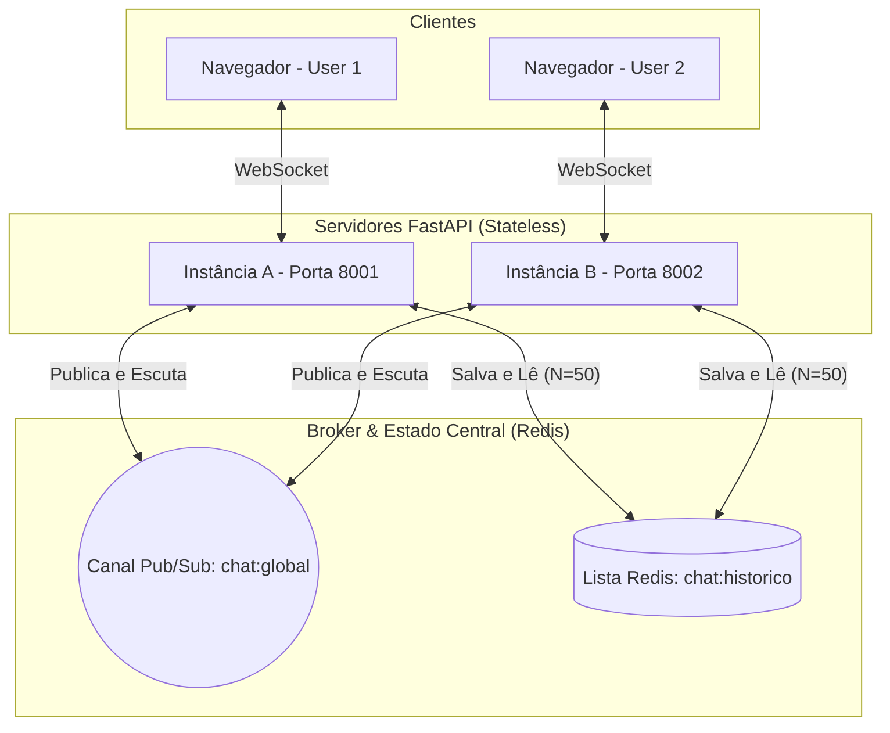

# Chat Distribuído - Equipe 11

Projeto da disciplina de Sistemas Distribuídos e Redes de Computadores.

## 👥 Equipe 11

* **Igor Soares**
* **Izadora Taline Gonçalves Andrade**
* **Mateus Barbosa de Oliveira Santos**
* **Mateus Martins Burgos**

## 1. Nossa Stack e Justificativa

Como a ideia do projeto é sair do modelo de sockets TCP puros e criar um chat que realmente escale horizontalmente, a gente decidiu usar a seguinte stack:

* **FastAPI (Python):** Escolhemos o FastAPI porque ele já vem com suporte nativo e assíncrono para WebSockets (usando o Uvicorn). Isso resolve o problema de travar o servidor, já que ele aguenta várias conexões abertas ao mesmo tempo sem bloquear a thread principal. Além disso, aproveitamos o Pydantic para validar os payloads logo na entrada.
* **Redis:** É o coração da nossa distribuição. Ele resolve dois problemas centrais que tínhamos na primeira versão do chat:
  1. **Pub/Sub (Barramento de Mensagens):** Se um usuário conecta na Instância A e outro na Instância B, essas instâncias não se enxergam direto. Usamos um canal no Redis para o broadcast: a Instância A publica a mensagem lá, e todas as outras que estão inscritas recebem e repassam para seus clientes.
  2. **Histórico centralizado:** As últimas 50 mensagens ficam salvas em uma lista na memória do próprio Redis. Assim, não importa em qual porta o usuário se conecte, ele sempre carrega o mesmo histórico.

## 2. Desenho da Arquitetura

Para simular um ambiente distribuído real, subimos duas instâncias independentes da nossa API (portas 8001 e 8002). Elas não trocam estado entre si diretamente, toda a sincronização é feita pelo Redis.



## 3. Protocolo de Comunicação (WebSocket)

Como usamos WebSockets, a comunicação acontece por meio de eventos no formato JSON.

**1. Entrando na Sala (Conexão)**
O cliente conecta enviando o nome de usuário na própria URL (Query String):
`ws://localhost:8001/ws?usuario=Mateus`

**2. O que o Servidor envia para o Cliente**
Assim que conecta, o servidor manda o histórico (últimas 50 mensagens). Depois, avisa quem entra, sai e as mensagens novas:
* `{"evento": "historico", "dados": [...]}`
* `{"evento": "usuario_entrou", "dados": {"usuario": "Mateus", ...}}`
* `{"evento": "nova_mensagem", "dados": {"usuario": "Igor", "texto": "E aí!", ...}}`
* `{"evento": "erro", "dados": {"mensagem": "Texto não pode ser vazio"}}`

**3. O que o Cliente envia para o Servidor**
O cliente só precisa mandar um evento para falar no chat:
* `{"evento": "enviar_mensagem", "texto": "Boa noite, pessoal!"}`

## 4. Como Rodar e Testar o Projeto (Passo a Passo)

### Pré-requisitos
- Python 3.9+ instalado.
- **Redis** baixado/instalado no Windows (ou via Docker: `docker run -d -p 6379:6379 redis`).

### 1. Instalando as Dependências (Apenas na primeira vez)
Abra o terminal na raiz do projeto, crie o ambiente virtual e instale as bibliotecas:
```bash
python -m venv venv
venv\Scripts\activate
pip install -r requirements.txt
```
*(Nota: Se o PowerShell bloquear o `activate`, rode antes: `Set-ExecutionPolicy -ExecutionPolicy RemoteSigned -Scope CurrentUser`)*

### 2. Ligando o Broker Redis (Obrigatório fazer primeiro)
- Vá até a pasta onde você extraiu o Redis no Windows.
- Dê um duplo clique no arquivo `redis-server.exe`.
- Confirme que a janela mostrou `Ready to accept connections` na porta 6379 e **deixe-a minimizada** (não feche).

### 3. Iniciando as Instâncias (A e B)
No Windows, basta dar um **duplo clique** no arquivo `iniciar_instancias.bat` que está na raiz do projeto. 
Ele abrirá automaticamente dois terminais ativando o ambiente virtual:
- Uma janela rodando a **Instância A** na porta `8001`
- Outra janela rodando a **Instância B** na porta `8002`

*(Verifique se ambas imprimiram `SERVIDOR_INICIADO` e `PUBSUB_INSCRITO` sem erros, e deixe as duas janelas abertas).*

### 4. Verificando a Saúde dos Servidores (Health Check)
Para confirmar se as APIs estão conectadas ao Redis, acesse no navegador ou use o terminal:
```bash
curl http://localhost:8001/health
curl http://localhost:8002/health
```
*A resposta esperada é: `{"status": "online", "redis_conectado": true}`.*

### 5. Testando o Chat na Prática (Clientes de Terminal)
Abra dois terminais lado a lado no VS Code (com o `venv` ativado) para simular usuários reais:

**Terminal 1 (Instância A):**
```bash
python client_cli.py 8001 Mateus
```
**Terminal 2 (Instância B):**
```bash
python client_cli.py 8002 Igor
```
- **Comunicação:** Digite uma mensagem em um terminal e dê Enter; ela aparecerá instantaneamente no outro.
- **Histórico Automático:** Abra um Terminal 3, rode `python client_cli.py 8002 Izadora` e veja as mensagens anteriores carregando na entrada.

### 6. Teste Automatizado (Pub/Sub do Redis)
Com as duas instâncias rodando nas janelas pretas, em um terminal extra no VS Code, rode o nosso script de teste:
```bash
python test_client.py
```
**O que esse script faz?**
Ele conecta o "UserDaInstanciaA" na porta 8001 e o "UserDaInstanciaB" na porta 8002. O usuário A envia uma mensagem e o script escuta a porta 8002 para ver se a mensagem chega lá via Redis. Você verá a mensagem de `[SUCESSO!]` no final.

### 7. Como Desligar Tudo no Final
1. Digite `/sair` nos terminais dos clientes (Passo 5).
2. Feche as duas janelas pretas das Instâncias (8001 e 8002).
3. Por último, feche a janela preta do `redis-server.exe`.